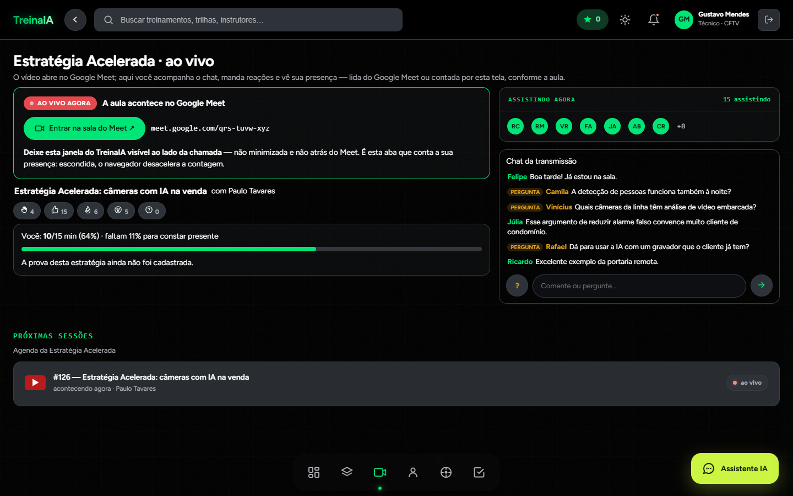
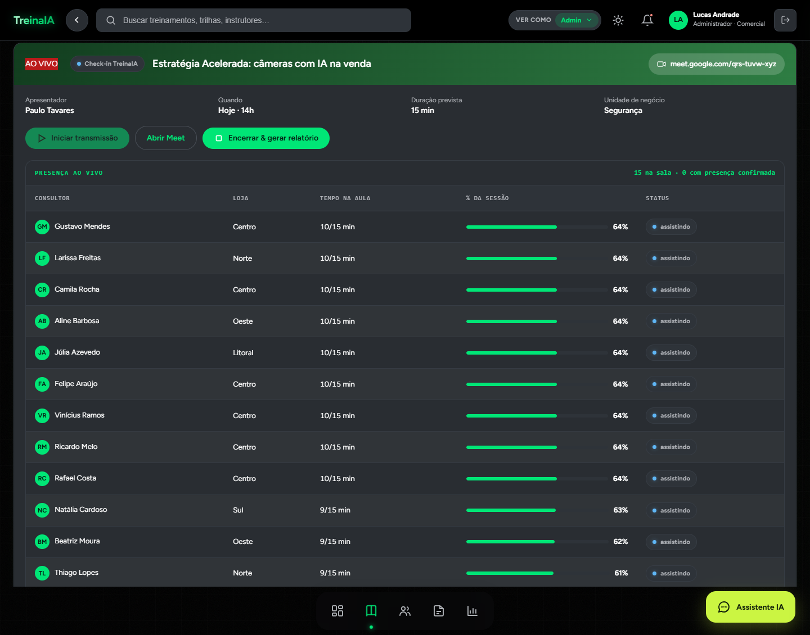
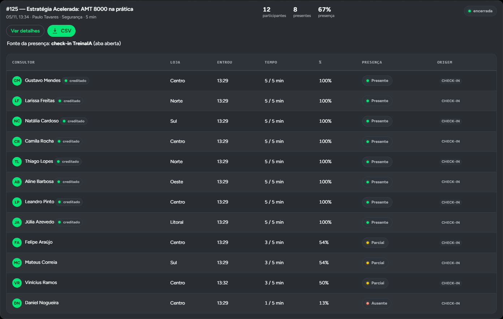
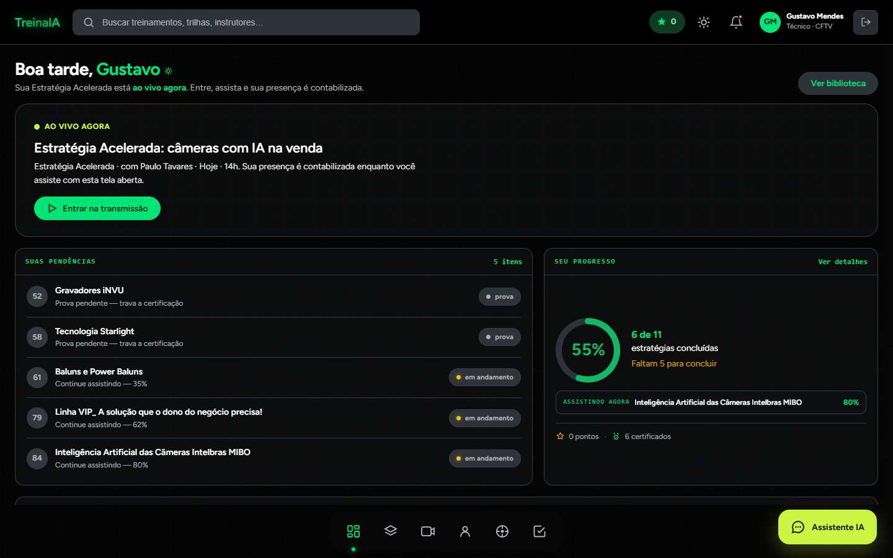
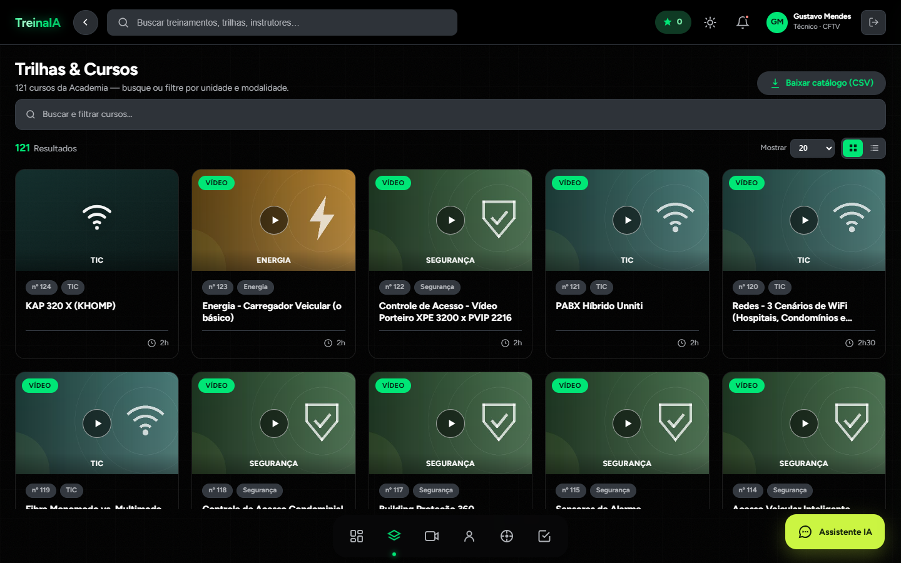
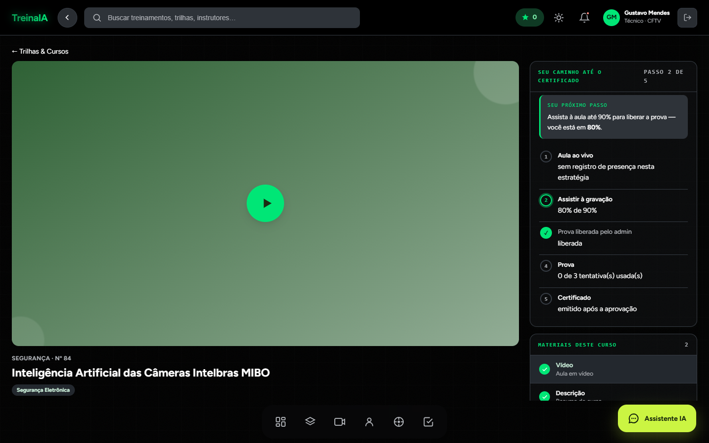
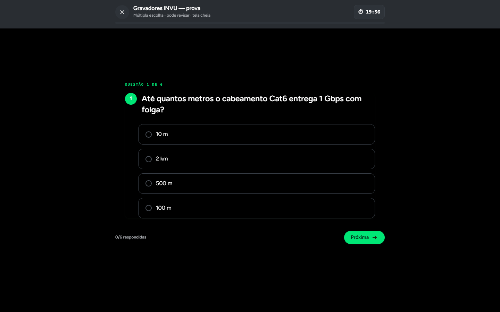
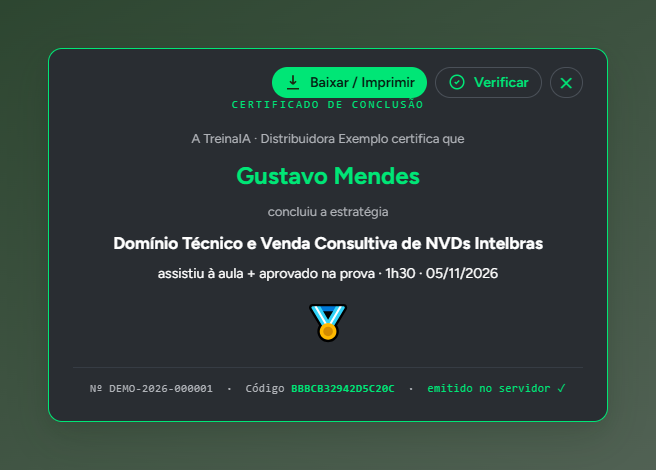

# TreinaIA

**Plataforma de treinamento própria: aula ao vivo com presença contada pelo servidor, prova e certificado.**

Feita para os consultores e técnicos de uma distribuidora de segurança eletrônica. A escolha foi construir em vez de assinar uma plataforma: licença por usuário não fechava a conta para a base inteira.

> Este repositório é uma vitrine: o código-fonte e os dados não fazem parte dele.
> As telas abaixo são de um ambiente de demonstração, com pessoas, unidades e atividade fictícias.

## As telas

**Aula ao vivo.** A aula acontece no Google Meet; o TreinaIA mostra quem está assistindo, recebe perguntas e reações e diz a cada um quanto falta para a presença contar.

<table>
<tr>
<td width="50%"> 
<b>Presença em tempo real</b> 
O admin acompanha os minutos e o percentual de cada pessoa enquanto a aula acontece.</td>
<td width="50%"> 
<b>Relatório da aula</b> 
Ao encerrar, cada pessoa fica Presente, Parcial ou Ausente pela régua da aula, e quem bateu a régua tem o curso creditado. Exporta em CSV.</td>
</tr>
<tr>
<td> 
<b>Início</b> 
A aula ao vivo do momento, as provas pendentes e quantas das aulas começadas faltam concluir.</td>
<td> 
<b>Catálogo</b> 
Mais de cem aulas de produto, com busca e filtro por unidade de negócio.</td>
</tr>
<tr>
<td> 
<b>Curso</b> 
O vídeo e os passos até o certificado: aula ao vivo ou gravação, prova liberada, aprovação.</td>
<td> 
<b>Prova</b> 
Múltipla escolha com tempo; a nota é calculada no servidor.</td>
</tr>
</table>

 
<b>Certificado</b>: emitido pelo servidor depois da aprovação, com número sequencial e código de verificação.

## O ciclo que sustenta o produto

Aula ao vivo → presença acima da régua credita o curso → prova → aprovação emite o certificado.

- **A presença é contada pelo servidor**, pelo sinal da aba aberta durante a aula, e só entre Iniciar e Encerrar. Há também integração com a API do Google Meet, que lê a lista de participantes a cada 20 s.
- **Lançamento manual existe**, mas aparece como manual no relatório, separado da presença medida.
- **Abaixo da régua**, a prova só abre depois da gravação (90% do vídeo, registrado pelo player).
- **A prova de uma aula nova nasce bloqueada** e só aparece quando o admin libera.
- **O certificado só é emitido depois da aprovação** na prova.

## No servidor

- A rota da prova entrega só enunciado e alternativas; nota e aprovação são calculadas no back-end.
- Se o servidor barra a prova, a tela mostra o motivo e não monta prova local.
- Perfis com permissões separadas: colaborador, gerente (vê só a própria unidade) e admin; qualquer pessoa pode ser marcada como apresentadora para conduzir aulas.
- Se o servidor reinicia no meio da aula, o tempo sem medição não vira presença, e o relatório mostra o intervalo ao admin.

## Por baixo

- Node.js sem dependências npm: um back-end de autenticação, presença, provas e certificados, e um servidor que entrega o app e o duelo de perguntas em tempo real.
- Banco em arquivo JSON com escrita atômica, backup a cada subida e log de auditoria.
- Senhas com scrypt e sal por pessoa; sessão com token de 256 bits e expiração.
- Front-end num único HTML, com tema claro e escuro, que funciona no celular. O assistente do app responde a partir de uma base de conhecimento com o catálogo de aulas.
- Portão de testes automatizados com 53 verificações, mais uma suíte da aula ao vivo que derruba o servidor no meio da aula de propósito.

---

Projeto desenvolvido para uso interno corporativo. Publicado como vitrine técnica, sem código de produção e sem dados reais.
